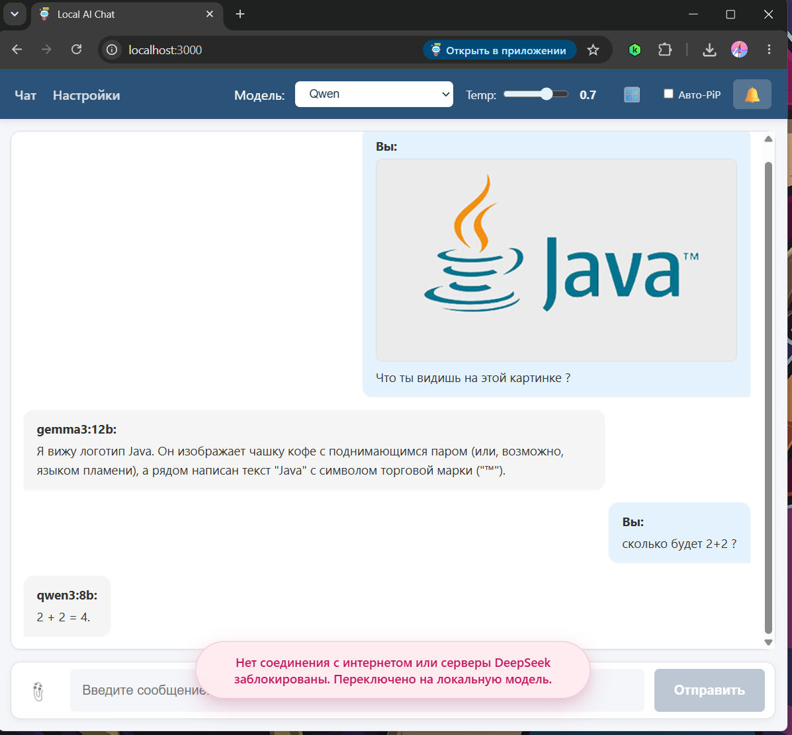
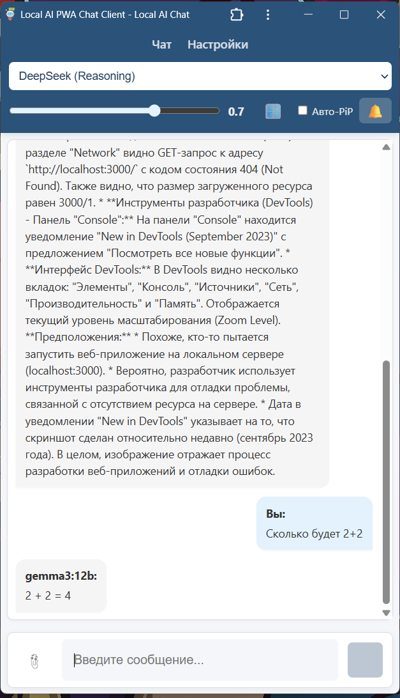
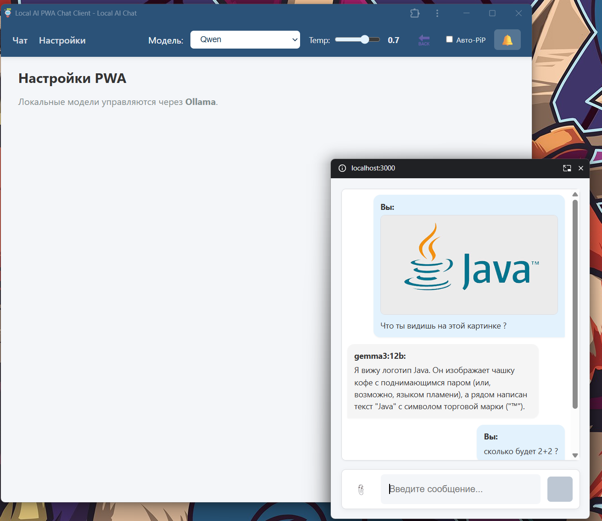

[](https://github.com/olegvelmisov607-tech/chat-ai/actions/workflows/ci.yml) $coverage$
# Local AI SPA+PWA Chat Client 🚀

Современное автономное веб-приложение (SPA/PWA) для работы с большими языковыми моделями (DeepSeek Cloud и локальная Ollama). Архитектура построена на **чистом JavaScript (Vanilla ES6+) без использования UI-фреймворков** и **нативном Node.js** на бэкенде.

Проект создан как учебный полигон (pet-project) уровня Middle+ для демонстрации современных подходов к веб-разработке: от Graceful Degradation и SSE-стриминга до мультимодальности (Vision) и продвинутых браузерных API (Picture-in-Picture, Notifications).

## ✨ Ключевые особенности

* **Мультимодальность (Vision):** Поддержка отправки изображений через скрепку, Drag-n-Drop или вставку из буфера (Ctrl+V). Файлы конвертируются в Base64. Бэкенд автоматически определяет наличие картинки и перенаправляет запрос на локальную Vision-модель (например, `gemma3:12b`), так как облачный DeepSeek не поддерживает изображения.
* **Эмуляция стриминга для Vision:** Поскольку Ollama имеет баги со стримингом при обработке картинок, бэкенд отключает нативный стрим (`stream: false`), получает ответ целиком и эмулирует SSE-поток для фронтенда, сохраняя единый UX.
* **Picture-in-Picture (PiP):** Благодаря Document PiP API (Chrome 116+) интерфейс чата можно вынести в отдельное плавающее окно поверх всех приложений.
* **Системные уведомления (Notification API):** Если пользователь свернул вкладку, по окончании генерации ответа придет нативное уведомление ОС.
* **Graceful Degradation (Cloud → Local):** Бэкенд автоматически переключается между облачным API DeepSeek и локальной Ollama. Если облако недоступно (нет интернета, ошибка 5xx, 429), клиент даже не заметит сбоя: ответ придет от локальной модели, а пользователь увидит аккуратное Toast-уведомление (один раз за сессию).
* **Circuit Breaker:** При повторяющихся ошибках облачного API, запросы к нему временно блокируются (на 30 секунд), чтобы не тратить время пользователя на ожидание таймаутов.
* **Умный UI:** Кнопка «Отправить» блокируется, если нет ни текста, ни прикрепленного изображения. Адаптивный дизайн для мобильных устройств.
* **SSR & SEO (Server-Side Rendering):** Сервер определяет поисковых ботов (Google, Yandex, Telegram) по заголовку `User-Agent` и отдает им готовый HTML-код с микроразметкой Schema.org (JSON-LD) и Open Graph. Обычные пользователи при этом получают SPA-приложение.
* **Streaming (SSE):** Реалтайм-рендеринг ответов моделей через `ReadableStream` и Server-Sent Events.
* **Настройка генерации (Temperature):** Ползунок температуры в UI, значение которого пробрасывается через всю цепочку (Client → API → Server → LLM) для управления креативностью модели.
* **Безопасный Reasoning (DeepSeek-R1):** Кастомный парсер тегов `<think>` (и поля `reasoning_content` от DeepSeek API) безопасно рендерит «рассуждения» модели без уязвимости XSS.
* **PWA & Offline Mode:** Полноценный Web App Manifest и Service Worker (стратегия Cache-first) для работы интерфейса без сети и установки приложения.
* **Local Storage:** Персистентное сохранение истории сообщений и прикрепленных картинок в IndexedDB.
* **Security (Auth & Rate Limit):** Защита локального инференса от несанкционированного доступа и DDoS (Bearer Token и in-memory Rate Limiter на базе IP).

## 🛠️ Стек технологий

* **Frontend:** Vanilla JS (ES6+ Modules), HTML5, CSS3 (Flexbox, CSS Variables, `100dvh`), PWA (Service Worker), Document PiP API, Notification API.
* **Backend:** Node.js (нативный модуль `http`, Streams API, SSE).
* **AI API:** OpenAI-совместимый API (DeepSeek Cloud + Ollama).
* **Сборка и Качество:** Webpack 5, Webpack Dev Server (HMR & Live Reload), ESLint v9 (Flat Config).
* **Тестирование:** Playwright (E2E с мокированием сетевых запросов, тестами UI-состояний и Vision-запросов).
* **Разработка:** Настроен HMR (без перезагрузки страницы при изменении CSS/JS) и отладка через VS Code (Chrome Debugger).
* **AI Agent Harness:** Настроены MCP-серверы (Puppeteer, GitHub) и кастомные Skills (например, `vanilla-js-audit`) для GigaCode.

## 📐 Архитектура Fallback и Vision

**1. Обработка текста (Fallback):**
* Клиент отправляет запрос на `/api/chat`.
* Бэкенд пробует отправить запрос в DeepSeek Cloud.
* Если облако отдает `401/403` (ошибка конфигурации) — бэкенд возвращает ошибку.
* Если сеть недоступна, таймаут или `5xx` — бэкенд включает Circuit Breaker и автоматически переключается на локальную Ollama.
* Клиент получает событие `system_alert` и показывает уведомление (один раз за сессию, чтобы не спамить).

**2. Обработка изображений (Vision):**
* Клиент отправляет Base64-картинку в формате OpenAI (`image_url`).
* Бэкенд перехватывает запрос, видит наличие картинки и подменяет модель на `vision` (маппинг в `config.js`).
* В `fallback.js` срабатывает проверка: `isCloudSupported = false` (DeepSeek не умеет картинки), поэтому запрос сразу уходит в Ollama (`gemma3:12b`).
* `openai-compat.js` отключает стриминг (`stream: false`), ждет полный ответ от Ollama и эмулирует SSE-поток для клиента.

## 📸 Скриншоты

### Десктопный вид (Роутинг между Vision и текстовой моделью)


### Мобильный вид (Адаптивная верстка)


### Picture-in-Picture (Отдельное окно)


## 🚀 Быстрый старт и Разработка

1. Установите зависимости:
   `npm install`

2. Создайте файл `.env` в корне проекта:
   ```env
   PORT=3000
   DEEPSEEK_API_KEY=sk-ваш_ключ
   DEEPSEEK_BASE_URL=https://api.deepseek.com/v1
   OLLAMA_BASE_URL=http://127.0.0.1:11434/v1
   AUTH_TOKEN=super-secret-token
   
3. Убедитесь, что Ollama запущена и модели скачаны (для текста: `qwen3:8b` или `deepseek-r1:7b`, для картинок: `gemma3:12b`).

4. **Режим разработки (HMR + Live Reload):**
   Откройте **два терминала**:
   * Терминал 1 (Бэкенд): `npm run dev:server`
   * Терминал 2 (Фронтенд): `npm run dev`
   Приложение откроется на `http://localhost:8080`.

5. **Production сборка:**
   `npm run build`
   `npm start`
   Приложение будет доступно на `http://localhost:3000`.

## 🔒 Безопасность и Деплой (Production)

Для выкатывания в интернет (на белый IP) настоятельно рекомендуется использовать **Nginx как Reverse Proxy**:
* Настройте SSL (Let's Encrypt / certbot).
* Отключите буферизацию (`proxy_buffering off`) для SSE-эндпоинта `/api/chat`, чтобы стриминг работал корректно.
* Ограничьте `limit_req` на уровне Nginx для защиты от DDoS.

## 🧪 Тестирование

E2E-тесты написаны на Playwright. Они **мокают** сетевые запросы, поэтому для их прохождения не требуется запущенная Ollama или API-ключ.

Тесты покрывают:
* Роутинг между экранами.
* Блокировку кнопки «Отправить» (когда нет текста и картинок).
* Загрузку картинки, появление превью и активацию кнопки.
* Полный цикл отправки картинки (с моком ответа от Vision-модели).
* Переключение температуры.
* Наличие кнопок PiP и уведомлений.
* Работу чекбокса «Авто-PiP».
* Запрос разрешения на уведомления.

Запуск:
`npm run test:e2e`

## 🔍 Как проверить SSR

Чтобы увидеть, что отдается поисковым ботам, выполните в терминале:
`curl -A "Googlebot" http://localhost:3000/`
Вы увидите чистый HTML с метатегами и микроразметкой. Для обычного пользователя в браузере отдается интерактивный SPA-клиент.